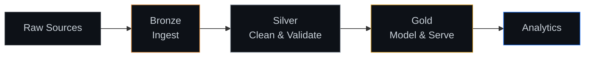

 
<!--
  GitHub Profile README
  Repository: nixxinix/nixxinix
-->

  

  

  

    
    
    
  

---

## About Me

Hi! I'm **King Rey Mark Samarita**, a Computer Engineering student interested in **Data Engineering** and building reliable, data-driven systems.

I'm developing my skills in Python, SQL, data warehousing, and ETL pipelines through academic work and hands-on learning projects.

- Working on SQL data warehousing and data transformation
- Learning data modeling, ETL/ELT, and data pipeline fundamentals
- Exploring Databricks, Apache Spark, and Microsoft Azure
- Interested in building efficient, reliable, and scalable data systems

## How I Think About Data

## Tech Stack

**Programming & Database**

  
  
  
  

**Data Engineering & Cloud**

  
  
  

## Featured Projects

### SQL Data Warehouse

A guided learning project based on a SQL Server data warehouse tutorial, used to develop practical data engineering skills.

- **Bronze Layer:** Load raw source data into staging tables
- **Silver Layer:** Clean, standardize, and validate data
- **Gold Layer:** Build dimension and fact tables for analytical use
- **SQL Development:** Practice joins, stored procedures, data quality checks, and transformations
- **Tools:** SQL Server, T-SQL, Git, and GitHub

*This project follows a tutorial. See the project repository for the original creator's credit and any personal extensions.*

**Original tutorial repository:** [sql-data-warehouse-project](https://github.com/DataWithBaraa/sql-data-warehouse-project)

> Replace the link above with your own repository once you've published your version. Keep the original tutorial credited in your README.

### MDSystem (EMR) - Academic Project

An academic electronic medical records system project focused on database management, SQL analytics, and UI/UX.

- Worked on database structure and organization
- Wrote 100+ SQL queries for retrieving, organizing, and analyzing data
- Contributed to UI/UX design to improve usability and navigation
- Used GitHub for version control and collaboration

**Tools:** SQL, Database Design, Data Analytics, Git, and GitHub

**Original tutorial repository:** [MDSystem](https://github.com/Cyber-Six/MDSystem)

## GitHub Statistics

  

  

## Currently Learning

- SQL and data warehouse design
- ETL/ELT and data pipeline fundamentals
- Data modeling and data quality
- Databricks and Apache Spark fundamentals
- Microsoft Azure fundamentals

## Connect with Me

  

I'm always looking to learn, build projects, and grow as an aspiring Data Engineer.

  

  Learning by building, one project at a time.

