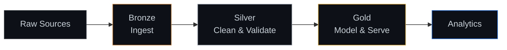

<!--
  GitHub Profile README
  Repository: nixxinix/nixxinix
-->

  

  

  

    
    
    
  

---

## About Me

Hi! I'm **King Rey Mark Samarita**, a Computer Engineering student interested in **Data Engineering** and building reliable, data-driven systems.

I'm developing my skills in Python, SQL, data warehousing, and ETL pipelines through academic work and hands-on learning projects. Along the way I also build full-stack web apps, computer vision models, and IoT systems.

- Working on SQL data warehousing and data transformation
- Learning data modeling, ETL/ELT, and data pipeline fundamentals
- Exploring Databricks, Apache Spark, and Microsoft Azure
- Interested in building efficient, reliable, and scalable data systems

## How I Think About Data

## Featured Projects

### Data Engineering

| Project | What it is | Stack |
|---|---|---|
| **[SQL Data Warehouse](https://github.com/nixxinix/sql-data-warehouse-project)** | CRM and ERP data integrated through Bronze, Silver, and Gold layers into a fact and dimension model, with data quality checks. Follows the [Data With Baraa](https://github.com/DataWithBaraa/sql-data-warehouse-project) tutorial. | SQL Server, T-SQL |
| **[MovieReco](https://github.com/nixxinix/MovieReco)** | Movie recommendation data engineering project. *Early setup.* | Microsoft Azure |

### Data Science and AI

| Project | What it is | Stack |
|---|---|---|
| **[Smart Road Object Detector](https://github.com/nixxinix/smart-road-object-detector)** | YOLOv8 model for 13 road-safety classes, from video frame extraction and quality filtering to a YOLO-ready dataset. | Python, OpenCV, YOLOv8 |

### Full-Stack and Web

| Project | What it is | Stack |
|---|---|---|
| **[InternQuest](https://github.com/nixxinix/InternQuest)** | Game-like internship and OJT finder for the Philippines with skill-based matching and gap insights. | Next.js, TypeScript, Supabase |
| **[HelmLock V2](https://github.com/nixxinix/helmlcok-v2-modular-demo)** | Configurable 3D simulator of a helmet storage and sanitation kiosk. | React, Three.js, Zustand |
| **[TIP MDS EMR](https://github.com/nixxinix/TIP_MDS)** | Electronic medical records system for TIP Medical-Dental Services. | Django, PostgreSQL |
| **[Product Cost Calculator](https://github.com/nixxinix/Product-Calculator)** | Production costing with profit and break-even analysis. Group project for CPE300. | Python, Flask |
| **[Portfolio](https://github.com/nixxinix/samarita-king-rey-mark-portfolio)** | My personal portfolio site. | React, Vite |

### IoT and Embedded

| Project | What it is | Stack |
|---|---|---|
| **[Smart Farm](https://github.com/nixxinix/Smart_Farm-Embedded-Project)** | Irrigation system that monitors soil and climate and runs a pump in auto or manual mode from a web dashboard. | ESP8266, Arduino, Flask |

### Team Contributions

**[MDSystem (EMR)](https://github.com/Cyber-Six/MDSystem)**, an academic electronic medical records system by Cyber-Six, focused on database management, SQL analytics, and UI/UX.

- Worked on database structure and organization
- Wrote 100+ SQL queries for retrieving, organizing, and analyzing data
- Contributed to UI/UX design to improve usability and navigation
- Used GitHub for version control and collaboration

## Tech Stack

**Data Engineering and Cloud**

  
  
  
  

**Languages**

  
  
  
  
  

**Web, AI, and IoT**

  
  
  
  
  
  
  

**Tools**

  
  
  

## GitHub Statistics

  

  

## Currently Learning

- SQL and data warehouse design
- ETL/ELT and data pipeline fundamentals
- Data modeling and data quality
- Databricks and Apache Spark fundamentals
- Microsoft Azure fundamentals

## Connect with Me

  
  

I'm always looking to learn, build projects, and grow as an aspiring Data Engineer.

  

  Learning by building, one project at a time.

